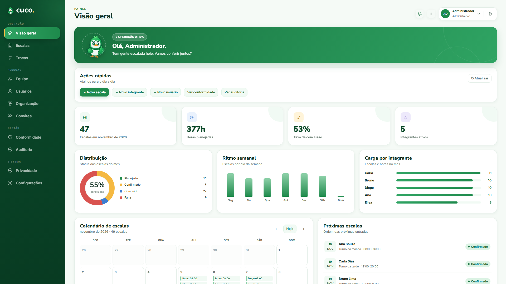

<p align="center">
  
</p>

# Cuco

**Projeto pessoal de portfólio — controle de escalas de trabalho com regras da CLT/EC 141, convites aprovados e auditoria, rodando localmente com Node 22 e SQLite.**

> Não é um produto de empresa: é um projeto que desenvolvi para estudar arquitetura de API, persistência local, autenticação e regras de negócio em um domínio real — a organização de escalas de trabalho.

## Problema

Pequenas operações ainda controlam escalas em planilha e WhatsApp. Com a EC 141/2026 (42h em 16/12/2026 e 40h em 16/12/2027, com dois dias de repouso e sem redução salarial), revisar escalas virou necessidade prática — não só teoria.

## Funcionalidades

- Escalas com formulário, filtros, troca de status e exportação CSV.
- Regras trabalhistas configuráveis e validação preventiva antes de salvar.
- Selo de publicação com hash SHA-256 e dossiê em PDF.
- Cadastro por convite com aprovação de vínculo pelo administrador.
- Perfis de administrador e funcionário com RBAC no servidor.
- Organização por setores, equipes e cargos; trocas de turno e notificações.
- Auditoria com usuário, IP e data.
- Privacidade LGPD com exportação e exclusão dos dados do titular.
- PWA com leitura offline.

## Telas

| Painel | Escalas | Conformidade |
| --- | --- | --- |
|  |  |  |

## Stack

Node.js 22 (`node:http`, `node:sqlite`, `node:crypto`), SQLite local, HTML/CSS/JS modules sem framework, ESLint, `node:test`, GitHub Actions e Docker Compose. Zero dependências de runtime.

## Como rodar

```bash
npm start
```

Abra `http://localhost:3000`. Na primeira vez, crie o administrador. Use `SEED_DEMO=1 npm start` para ver dados de exemplo.

```bash
npm test         # 32 testes
npm run lint
npm run check
npm run backup
```

## O que aprendi

- Desenhar API REST sem framework, com validação centralizada e migrações incrementais em SQLite.
- Implementar sessão assinada, CSRF, RBAC no servidor e revogação de token.
- Escrever regras de negócio testáveis (jornada, repouso, horas extras) e gerar PDF sem dependências.
- Documentar um projeto para que outra pessoa consiga rodá-lo em minutos.

## Roadmap

1. Relatórios de custo de mão de obra.
2. Regras por convenção/categoria com vigência datada.
3. Dossiê assinado digitalmente.
4. Notificações externas com consentimento registrado.

## Licença

Copyright © 2026 Marcos Moraes. BSL 1.1 com conversão para MIT em 19/11/2030. Ver `LICENSE` e `NOTICE`.

Contato: marcosfeliphe404@gmail.com · [LinkedIn](https://www.linkedin.com/in/marcos-moraes-2281a234b/)
