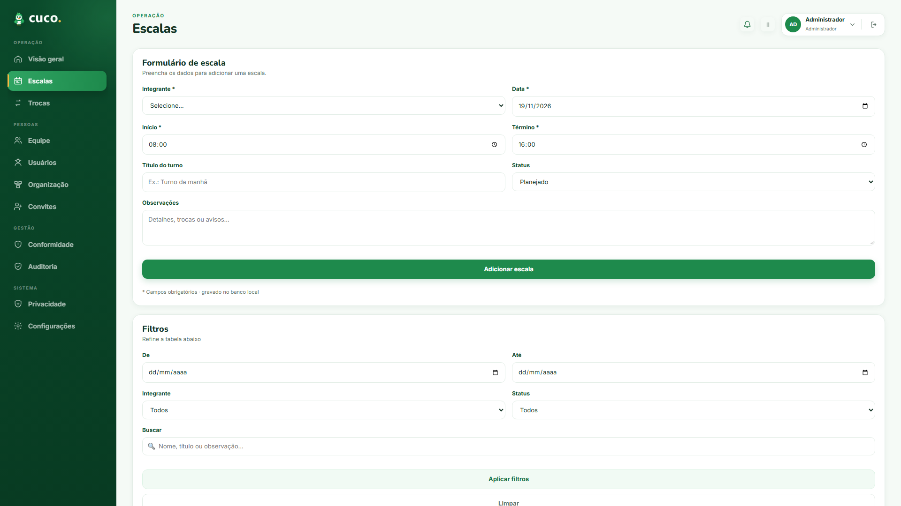
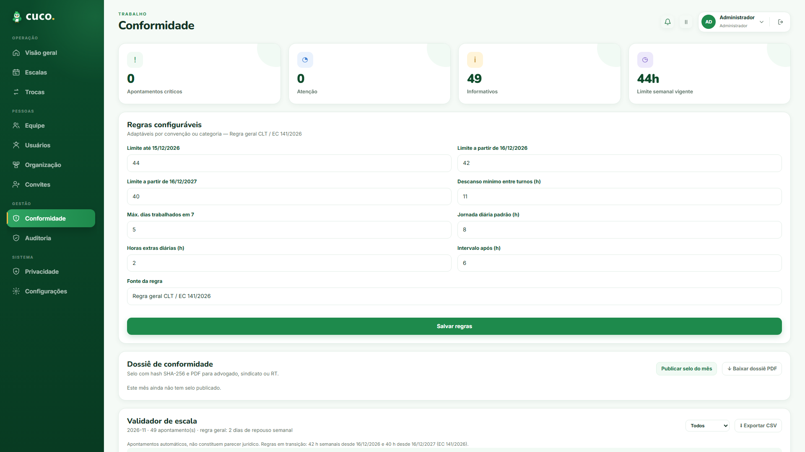

<p align="center">
  
</p>

# Cuco

**Controle de escalas de trabalho com conformidade trabalhista, convites aprovados e auditoria — rodando localmente, sem dependências de runtime.**

O Cuco nasceu para resolver um problema comum em pequenas operações: a escala vive no WhatsApp, numa planilha ou na cabeça do gestor. Ele reúne escala, equipe, acesso e evidência em um único painel, com regras da CLT e da EC 141/2026 verificadas antes da publicação.

> Copyright © 2026 Marcos Feliphe. Código sob [Business Source License 1.1](LICENSE). Nome, logo e mascote são marcas protegidas ([NOTICE](NOTICE)).

## Funcionalidades

- **Visão geral** — indicadores do mês, distribuição por status, ritmo semanal, carga por integrante e calendário.
- **Escalas** — cadastro e edição com formulário, filtros, busca, tabela, troca rápida de status e exportação CSV.
- **Conformidade** — regras configuráveis (jornada, repouso, intervalo, extras), validação preventiva no ato de salvar, selo com hash SHA-256 e dossiê em PDF.
- **Acesso por convite** — o administrador gera um código; o usuário se cadastra com o código; o vínculo só entra em vigor após aprovação.
- **Perfis** — administrador e funcionário, com permissões verificadas no servidor.
- **Organização** — setores, equipes e cargos; integrantes vinculados a cada um.
- **Trocas de turno** — solicitação do funcionário, aprovação do administrador e notificações.
- **Auditoria** — trilha de ações com usuário, IP, user-agent e data.
- **Privacidade (LGPD)** — aviso, exportação e exclusão dos dados do titular.
- **PWA** — instalável no celular, com cache offline para leitura.

## Telas

| Painel | Escalas | Conformidade |
| --- | --- | --- |
|  |  |  |

## Stack

- **Runtime:** Node.js 22.5+ (`node:http`, `node:sqlite`, `node:crypto`) — zero dependências de runtime.
- **Banco:** SQLite local em `data/cuco.db`, com migrações incrementais.
- **Front:** HTML, CSS e JavaScript modules (sem framework/build).
- **Segurança:** scrypt + salt, cookie `HttpOnly` assinado, CSRF, RBAC, rate limit, validação de MIME/assinatura de imagem.
- **Qualidade:** ESLint, `node --test`, GitHub Actions, Docker Compose.

## Como rodar

```bash
npm start
```

Abra `http://localhost:3000`. Na primeira vez, a tela **Criar administrador** é exibida — o nome já vem preenchido com Marcos Feliphe e o usuário `marcos`; use **Gerar senha principal** para criar uma senha forte.

Variáveis de ambiente (veja `.env.example`): `PORT`, `HOST`, `SESSION_SECRET`, `SECURE_COOKIES`, `TRUST_PROXY`, `DB_PATH`, `SEED_DEMO`.

```bash
npm run dev      # reinício automático
npm test         # testes de integração e unidade
npm run check    # sintaxe de todos os .js
npm run lint     # ESLint
npm run backup   # cópia segura do banco (VACUUM INTO)
```

Para rodar com dados de demonstração: `SEED_DEMO=1 npm start`.

## Documentação

- [Arquitetura](docs/ARCHITECTURE.md)
- [Pesquisa e decisões de produto](docs/RESEARCH.md)
- [Checklist de publicação](docs/PUBLISH_CHECKLIST.md)
- [Contribuindo](CONTRIBUTING.md) · [Código de conduta](CODE_OF_CONDUCT.md) · [Changelog](CHANGELOG.md) · [Segurança](SECURITY.md)

## Roadmap

1. Relatórios de custo de mão de obra e horas extras.
2. Regras trabalhistas por convenção/categoria com vigência datada.
3. Dossiê de conformidade em PDF assinado digitalmente.
4. Notificações externas (e-mail/Web Push) com consentimento registrado.

## Licença e uso

Código sob **BSL 1.1**: uso não-produtivo permitido; produção exige licença comercial; conversão para **MIT em 19/11/2030**. A ideia, o nome e a mascote são protegidos — um repositório público pode ser clonado, então não publique dados reais, credenciais, clientes ou banco de produção.

Para licença comercial: marcosfeliphe404@gmail.com.
